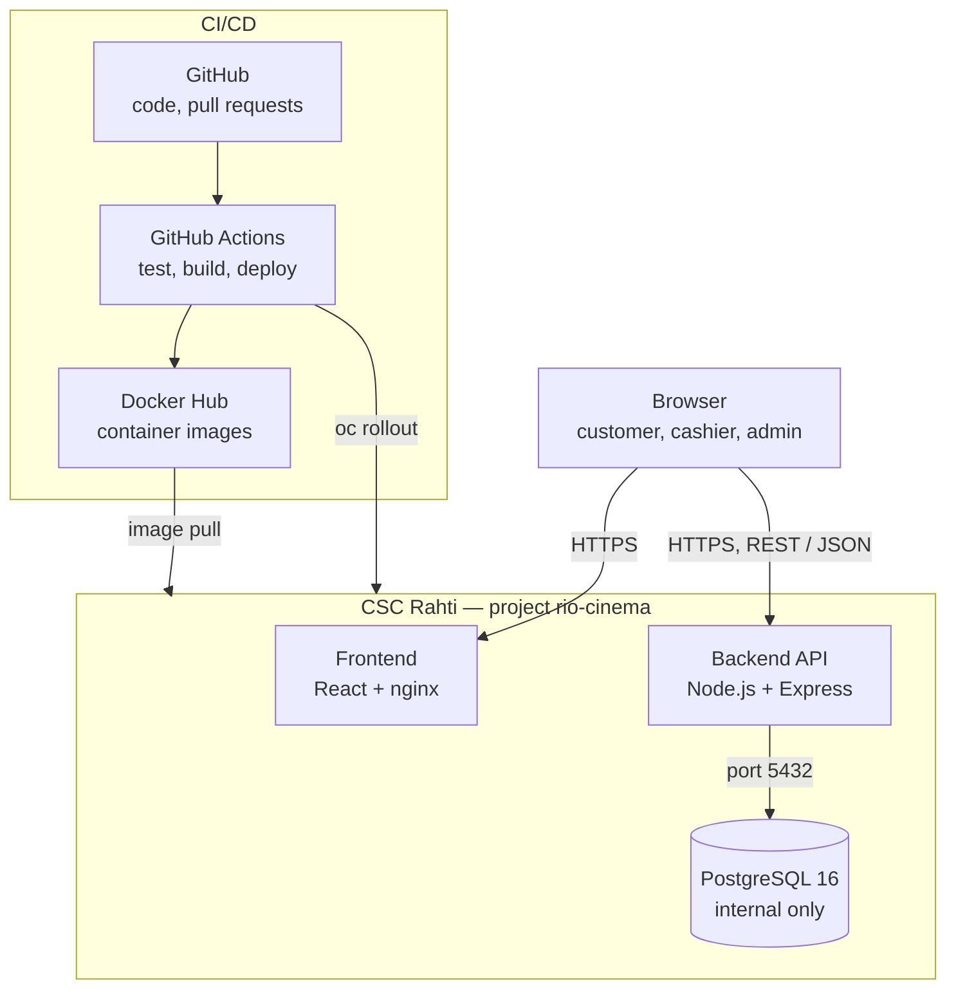
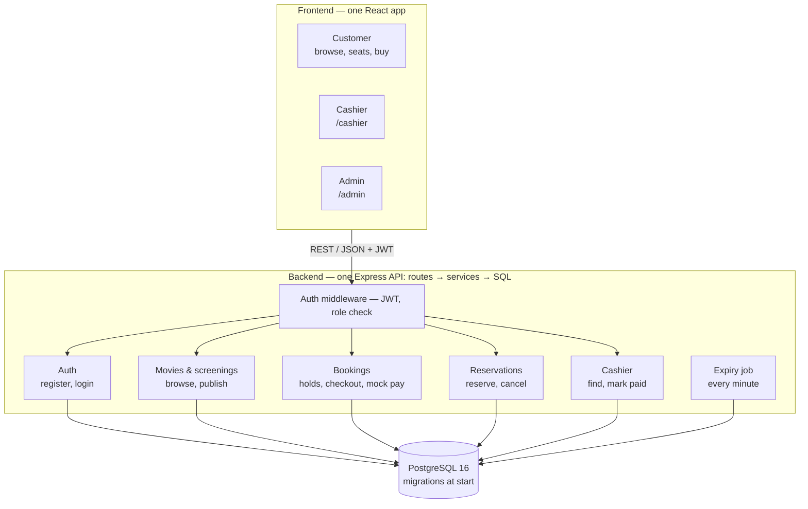

# Architecture — Rio Theatres

Version 1 (Sprint 1, 2 Nov 2026). The diagrams are reviewed at the end of every sprint.

## 1. Deployment



## 2. Logical structure



## 3. Architecture decisions

| #     | Decision                                                                                                   | Reason                                                       |
| ----- | ---------------------------------------------------------------------------------------------------------- | ------------------------------------------------------------ |
| AD-1  | One React app with customer (`/`), cashier (`/cashier`) and admin (`/admin`) areas; routes guarded by role | One build and deploy; shared components such as the seat map |
| AD-2  | One Express API split into domain modules                                                                  | Simple enough for 3 developers; microservices are not needed |
| AD-3  | Each module has three layers: routes (HTTP) → services (business rules) → db (SQL)                         | Business rules in one place and testable                     |
| AD-4  | Plain SQL with `pg`, no ORM                                                                                | Simple transactions for seat locking                         |
| AD-5  | SQL migrations in `Database/migrations`, run by the backend at start (`schema_migrations` table)           | Works the same locally and on Rahti                          |
| AD-6  | E-mail + password, JWT with role; `requireRole()` middleware on every protected endpoint                   | Server enforces authorisation                                |
| AD-7  | `booking_seats` table with a unique constraint on (screening, seat); holds created in a transaction        | The database prevents double booking                         |
| AD-8  | Expiry job every minute + expiry check when seats are read                                                 | No extra infrastructure                                      |
| AD-9  | Mock payment step in the app; Stripe test mode optional                                                    | One reliable flow without external dependency                |
| AD-10 | REST + JSON under `/api`; times stored as `TIMESTAMPTZ`; seat map without real-time updates                | Simplicity                                                   |

MVP simplifications and what a production system would still need are documented in the requirements specification, section 8.1.

## 4. Backend folder structure

```
Backend/src/
├── app.js
├── index.js
├── db.js
├── middleware/
│   └── auth.js              # verify JWT, requireRole()
├── modules/
│   ├── auth/                # auth.routes.js, auth.service.js, auth.db.js
│   ├── movies/
│   ├── screenings/
│   ├── bookings/
│   ├── reservations/
│   └── cashier/
└── jobs/
    └── expiry.js
```
